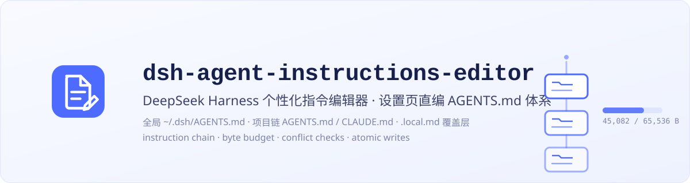
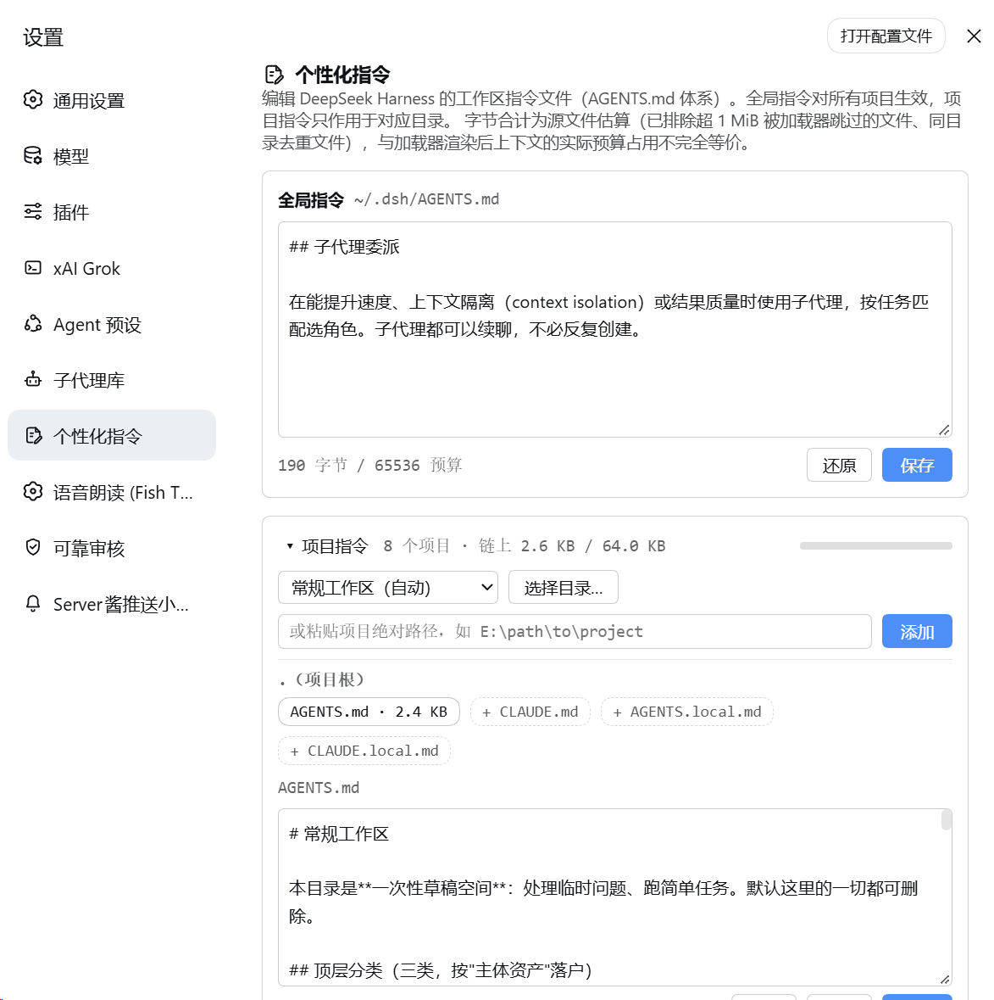

# dsh-agent-instructions-editor

**中文 | [English](./README.en.md)**

<p align="center">
  
</p>

<p align="center">
  
  
  
</p>

> **English:** dsh-agent-instructions-editor adds a 个性化指令 (Personalization)
> settings page to the [DeepSeek Harness](https://github.com/deepseek-ai/deepseek-harness)
> Web GUI for editing the harness workspace instruction files — the user-global
> `~/.dsh/AGENTS.md`, project-chain `AGENTS.md`/`CLAUDE.md` files, and
> `AGENTS.local.md`/`CLAUDE.local.md` overlays — in the spirit of Codex's
> personalization settings. See [README.en.md](./README.en.md) for the full English version.

## 简介

DeepSeek Harness 的个性化指令编辑插件：在 Web 设置页里直接编辑指令文件体系（对标 Codex 的「个性化」设置），由全局编辑器 + 项目链浏览器 + 覆盖层组成，带字节预算显示与「新会话生效」提示。

- **全局指令**：常驻编辑器，读写 `~/.dsh/AGENTS.md`，显示字节预算（默认 65,536）。
- **项目指令**（默认折叠）：项目选择器（自动发现：工作区注册表 + 最近会话目录；也可手动粘贴路径）→ 按「项目根 → 工作目录」逐层展示每层的 4 个候选槽位（AGENTS.md / CLAUDE.md / AGENTS.local.md / CLAUDE.local.md），存在即可点击编辑，不存在可新建。
- **与加载器相同的发现规则**：项目链发现、按目录内容去重（⧉ 徽标）、字节合计与预算条，遵循 `@deepseek-ai/dsh-agent-instructions` 的同一套规则。
- **受控的写入**：文件名白名单 + realpath 项目根包含校验 + mtime 冲突检测（409 → 重新加载或覆盖）+ 临时文件原子替换；同一 dsh web 进程内对同一文件的写入按队列串行化，使用旧修改时间的普通保存会收到 409 提示。
- **生效提示**：保存后建议新建会话。编辑器不会直接替换已有会话中的指令；已有会话何时重新读取由宿主加载器决定。

## 界面预览



全局指令和项目指令可在同一设置页查看与编辑。截图中的界面语言为中文。

## 宿主与桌面端兼容

版本 **0.2.3 面向 DSH 0.2**，适配基线为 `0.2.0-rc.2`。本次修复深色主题下「个性化指令」项目切换下拉未选中项白底白字的问题；0.2.2 为插件管理页增加随客户端语言切换的中英文名称与简介。桌面客户端沿用 Web 插件界面，无需另一份桌面专用包。变更记录见 [CHANGELOG.md](./CHANGELOG.md)。

**仍使用 DSH 0.1 的用户请保留插件 0.1.2**（npm 安装指定 `dsh-agent-instructions-editor@0.1.2`），不要直接升级到本版。开发依赖与 CI 基线已更新到 DSH `0.2.0-rc.2`；指令文件的发现规则、保存安全边界和「新会话生效」语义保持不变。

## 安装

桌面客户端与 Web 实例的插件安装及启用状态完全独立。请根据你使用的运行环境选择对应方式：

### 桌面客户端安装（推荐）

通过桌面客户端界面安装（无需配置命令行）：

1. 打开桌面客户端左侧栏**「插件 / Plugins」**，点击右上角**「添加插件 / Add plugin」**；
2. 输入 npm 包名 `dsh-agent-instructions-editor@latest` 并确认安装；
3. 安装完成后点击**「立即启用 / Enable now」**（若直接关闭安装完成弹窗，插件会保留在已安装列表中但处于未启用状态）；
4. 仅在界面提示需要重启时，通过菜单完整退出应用（**Quit**）后重新打开（在 Windows / macOS 上直接关闭窗口可能仅隐藏到后台）；
5. 识别点：打开 **Settings**，确认侧栏设置项中出现**「个性化指令」**。

<details>
<summary>备选：桌面端终端安装（Windows / macOS）</summary>

若偏好终端管理，可使用桌面配套 CLI：

1. 在桌面客户端应用菜单中选择 **Manage dsh Command…** → **Install**（注册桌面配套命令，若提示 PATH 冲突按其指引处理），并打开新终端；
2. 确保桌面客户端已至少启动过一次以完成初始化，并先通过 **Quit** 完整退出桌面客户端；
3. 在新终端中执行桌面专用命令安装与检查：
   ```sh
   dsh plugin --profile desktop add dsh-agent-instructions-editor@latest
   dsh plugin --profile desktop list
   ```
4. 重新启动桌面客户端。

> 注意：通过外部 npm / npx 安装的普通 `dsh` CLI 无法管理 desktop profile。关于桌面配套命令机制，详见官方桌面端文档的 [bundled-command-runtime](https://github.com/deepseek-ai/deepseek-harness/blob/dsh-v0.2.1-rc.2/apps/desktop/README.md#bundled-command-runtime)。
</details>

### Web 实例安装

Web 实例通过匹配的命令行工具进行管理。优先使用启动该 Web 实例的同一套匹配宿主的 `dsh` CLI：

```sh
dsh plugin --profile web add dsh-agent-instructions-editor@latest
```

然后**重启 dsh web**（停止当前进程，再运行 `dsh web`）并刷新页面。

其他安装方式：

```sh
# npm 安装不可用时，可改为从 GitHub 固定 0.2.3 tag 安装
dsh plugin --profile web add github:MaRi23333/dsh-agent-instructions-editor#v0.2.3
```

两种方式都在重启 dsh web 后生效。

> **说明**：若使用 `npx` 执行安装命令，请固定为与你的 Web 宿主相同的版本（例如 `npx @deepseek-ai/dsh@0.2.0-rc.2 ...`）。从本地目录或 GitHub 安装切换到 npm 时，请务必带上 `@latest`，以免已有安装被判定为已满足而跳过更新。

环境要求：DSH 0.2（本版适配基线 `0.2.0-rc.2`）、Node.js 22+、pnpm，以及与所装宿主匹配的 DSH CLI。无需本地构建：npm 包与 GitHub 仓库都附带 `lib/` 构建产物。

## 安全模型与已知限制

- 所有路由校验 Host 头必须为 loopback 字面量（`127.x.x.x` / `localhost` / `[::1]`，任意端口）——封死 DNS rebinding；POST 额外要求 JSON content-type 与严格同源 Origin（无 Origin 的本机脚本客户端不受影响）。
- 写路径：文件名白名单（4 个候选）+ 目录 realpath 必须落在已注册项目的「项目根→工作目录」祖先链内 + mtime 冲突栅栏（409）+ 临时文件原子替换。同一进程内对同一目标的写入经内存队列串行化，mtime 栅栏在队列内复检；跨进程没有文件锁——外部编辑器等其他进程同时保存同一文件时，栅栏复检与 rename 之间仍有极小竞态窗口，理论上可能静默丢失一次外部更新（与常规编辑器一致）。本机恶意进程与本用户同信任级别（可直接改磁盘文件），不在防御边界内。
- 指令文件本身是 symlink 时读取会跟随目标（与官方加载器同暴露面）；写入通过 rename 替换 symlink 本身，不会写穿目标。
- 编辑器按部署预置的加载器默认值工作（markers=`[.git]`、候选 4 件套、预算 65,536）；若用户修改 dsh-base 的 agent-instructions 配置（自定义 markers/候选/预算），编辑器展示会随之漂移。
- UI 文案当前为硬编码中文（locale 字典已注册，供后续接入 `t()`）。

## 架构

- **Host 半区**（`src/index.ts`）：自有 HTTP 路由 `/agent-instructions/api/{projects,chain,file}`；手动项目注册表存放在本插件的 profile 条目中，通过 DSH 0.2 的 `SettingsForms` 接口读写，保存携带 revision 冲突检测。
- **Client 半区**（`src/client/`）：`settings.section` 槽位贡献设置页；纯 textarea 编辑器（零额外依赖）。
- **发现逻辑**（`src/chain.ts`）：按指令加载器的规则逐条复刻（marker 上溯、祖先链、候选探测、目录内 sha1(trim) 去重），纯 Node 可单测。

## 开发

```sh
pnpm install --frozen-lockfile
pnpm run typecheck
pnpm run test      # 发现、写入与编辑状态单测
pnpm run build     # tsdown：lib/index.js（host）+ lib/client.js（browser）
pnpm run smoke     # smoke-host.mjs + smoke-client.mjs
pnpm run check:pack
```

- 开发依赖锁定 DSH `0.2.0-rc.2`。`pnpm-workspace.yaml` 的 overrides 出于两个原因全量精确钉版：
  1. pnpm 11.21.0 会把 `^0.2.0-rc.2` 这类带预发布下界的 caret 范围错误展开为 `>=0.2.0 <0.3.0-0`（排除了 `0.2.0-rc.2` 自身），导致 NO_MATCHING_VERSION；
  2. 已内联、停更的 `@deepseek-ai/dsh-client-runtime` / `@deepseek-ai/dsh-host-apiproxy` 保留 `0.1.1-rc.2`，`@deepseek-ai/dsh-agent-presets` / `@deepseek-ai/dsh-code-runtime` 保留 `0.1.5-rc.3`。
- 这些依赖仅用于类型检查与测试，不进入发布产物（见 [THIRD_PARTY_NOTICES.md](./THIRD_PARTY_NOTICES.md)）。

## License

[MIT](./LICENSE)。本发布产物不内联任何第三方代码，说明见 [THIRD_PARTY_NOTICES.md](./THIRD_PARTY_NOTICES.md)。

本插件是独立社区项目，与 DeepSeek 无任何隶属或背书关系；`DeepSeek Harness` 名称仅用于标明兼容平台。
